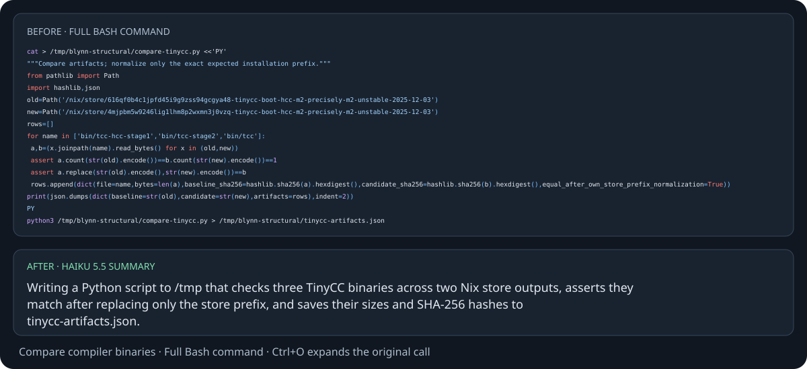

# Pi Tool Summaries



Plain-language summaries of Bash, PowerShell and codemode tool calls.

## Install

Requires **Pi 0.84.4+ (<2)** and Node 22.19+ (Node 24 also supported). PowerShell and codemode summaries require Pi 1.0.1+; Bash summaries continue to work on earlier supported releases. CI covers the pinned Pi 1.0.1 and Pi 0.84.4, 0.99.2, and 1.3.0. See [compatibility and testing](docs/compatibility.md) for the OS matrix and its limits.

```sh
pi install npm:pi-tool-summaries
```

Restart Pi or run `/reload`. Use `/tool-summaries` to inspect the effective model and status. Visible built-in Bash and PowerShell calls are summarized; when Pi's `codemode` tool is active, its JavaScript calls are summarized too.

**Privacy and cost:** eligible calls send their full arguments (including the command/script and any inline credentials, internal URLs, or proprietary code) to the selected summary provider. Tool results and conversation history are not sent by this extension. Summaries add model requests and may incur provider charges or consume subscription quota. The default reuses your current Pi model; a dedicated model is an additional disclosure destination. Use `/tool-summaries off` to pause requests, or `"toolSummaries": { "enabled": false }` to disable them persistently.

## Before and after

The compiler-binary comparison below shows an existing command and its summary from this README.

Press **Ctrl+O** to expand the original command; tool results remain unchanged. Summaries describe intended actions, not verified execution or a safety audit. Inspect the original before relying on a description, particularly for destructive commands.

### Compare compiler binaries

<details>
<summary>Before: full Bash command</summary>

```sh
cat > /tmp/blynn-structural/compare-tinycc.py <<'PY'
"""Compare artifacts; normalize only the exact expected installation prefix."""
from pathlib import Path
import hashlib,json
old=Path('/nix/store/616qf0b4c1jpfd45i9g9zss94gcgya48-tinycc-boot-hcc-m2-precisely-m2-unstable-2025-12-03')
new=Path('/nix/store/4mjpbm5w9246lig1lhm8p2wxmn3j0vzq-tinycc-boot-hcc-m2-precisely-m2-unstable-2025-12-03')
rows=[]
for name in ['bin/tcc-hcc-stage1','bin/tcc-stage2','bin/tcc']:
 a,b=(x.joinpath(name).read_bytes() for x in (old,new))
 assert a.count(str(old).encode())==b.count(str(new).encode())==1
 assert a.replace(str(old).encode(),str(new).encode())==b
 rows.append(dict(file=name,bytes=len(a),baseline_sha256=hashlib.sha256(a).hexdigest(),candidate_sha256=hashlib.sha256(b).hexdigest(),equal_after_own_store_prefix_normalization=True))
print(json.dumps(dict(baseline=str(old),candidate=str(new),artifacts=rows),indent=2))
PY
python3 /tmp/blynn-structural/compare-tinycc.py > /tmp/blynn-structural/tinycc-artifacts.json
```

</details>

**After:**

> Writing a Python script to /tmp that checks three TinyCC binaries across two Nix store outputs, asserts they match after replacing only the store prefix, and saves their sizes and SHA-256 hashes to tinycc-artifacts.json.

### Check benchmark results

<details>
<summary>Before: full Bash command</summary>

```sh
python3 - <<'PY'
import json,statistics,pathlib
root=pathlib.Path('/tmp/blynn-ablation-20260921')
r=json.loads((root/'summary.json').read_text())
cs=[x['first_selfhost_seconds'] for x in r if x['variant']=='control']
b=statistics.mean(cs)
print('CONTROL',cs,'mean',b,'range',max(cs)-min(cs),'stdev',statistics.stdev(cs))
for x in r:
 print(x['variant'],x['first_selfhost_seconds'],round(x['first_selfhost_seconds']-b,2),round(100*(x['first_selfhost_seconds']/b-1),2),x['derivations'])
assert len(r)==12
for x in r:
 assert x['artifacts']['bin/tcc-stage2']['sha256']==x['artifacts']['bin/tcc']['sha256']
 for p in x['artifacts']:
  assert x['artifacts'][p]['normalized_sha256']==r[0]['artifacts'][p]['normalized_sha256']
print('Verified every TinyCC artifact and fixed point.')
for x in r:
 rows=[s.split('\t') for s in (root/'results'/(x['label']+'.tsv')).read_text().splitlines()]
 group={k:0 for k in ['seed','raw','party','hcc','tinycc','other']}
 for row in rows:
  n=row[1];t=float(row[2]);g='other'
  if 'tinycc-' in n:g='tinycc'
  elif 'hcc-blynn-' in n or n.startswith('hcc-m2-'):g='hcc'
  elif 'blynn-upstream-' in n:g='party'
  elif 'blynn-' in n and any(a in n for a in ['raw-','marginally-','methodically-','vm-','blob-','pack-blobs-']):g='raw'
  elif not 'blynn-' in n and not 'mes-libc' in n:g='seed'
  group[g]+=t
 print(x['label'],{k:round(v,2) for k,v in group.items()})
PY
```

</details>

**After:**

> Comparing the first self-host timings of 12 Blynn ablation variants against the control mean and spread, asserting that every TinyCC artifact and normalized hash matches (aborting if not), and totaling each variant's per-step durations by category from its TSV file.

## Privacy controls

`/tool-summaries off`, `on`, or `toggle` changes request generation for the current runtime session only. Pausing cancels in-flight requests and queued backfill; it cannot undo data already sent or provider billing. Saved summaries remain visible. Reloading or switching sessions restores the configured `enabled` value.

For persistent controls in Pi settings:

```json
{
  "toolSummaries": {
    "enabled": true,
    "exclude": ["Authorization", "PRIVATE_INTERNAL_HOST", "confidential/"]
  }
}
```

`exclude` is an array of case-sensitive **literal substrings**, not regular expressions or path globs. A match anywhere in the serialized tool arguments skips the whole request, including forced backfill. Strings with quotes, backslashes or newlines must match their JSON-serialized representation. Trusted project settings replace the global exclusion array rather than extending it. At most 100 entries of 1–1000 characters are accepted. This is not a secret detector: it cannot guarantee redaction or safe disclosure. Prefer disabling summaries for sensitive projects rather than relying on patterns.

## Readiness and recovery

Run `/tool-summaries` to see the selected model, credential readiness, and the last safe failure reason. Readiness resolves credentials through Pi (including supported OAuth refresh); it is **not** a network/billing probe. Raw provider errors and credentials are never displayed.

Authentication/access errors and HTTP 429 responses pause requests to that model for 60 seconds. Three consecutive provider failures also start a cooldown. A problem is notified once per model until an explicit `retry` or runtime reset, not once per tool call. No automatic retries or model/provider fallbacks are made. Tool execution and the original view continue normally.

After `/login`, fixing configuration, or waiting for provider recovery, run `/tool-summaries retry` to clear cooldowns immediately, or `/reload`. Otherwise the next eligible call after cooldown expiry tries again. `retry` does not execute old commands or regenerate old summaries; use backfill for those.

## Backfill earlier calls

Run `/tool-summaries backfill` to generate missing summaries in the last 100
messages on the current conversation branch, or `/tool-summaries backfill 200`
to choose a different message count. Add `--force`, as in
`/tool-summaries backfill 200 --force`, to regenerate existing summaries. The
count includes all message roles, not just eligible tool calls. Without
`--force`, existing summaries are skipped; previously failed summaries can be
retried. The usual source-length and input-size limits apply.

Backfill makes one model request at a time, waiting for capacity shared with live
summaries. It uses the summary model selected when the command starts and incurs
normal provider costs. `/tool-summaries cancel` stops only backfill, leaving live summaries running; `/tool-summaries off` cancels both. Cancellation cannot undo already-sent requests or charges. Backfill stops early on a model cooldown or request cap rather than hammering every recorded call. It never executes the recorded commands. Completed
summaries refresh their rows and are saved in the Pi session (memory only with
`--no-session`). Closing or changing sessions cancels unfinished work.

## Usage and request caps

`/tool-summaries` reports generation attempts, provider-reported input/output/cache tokens, and estimated USD cost. Counts include failed generation attempts and final responses with unusable summaries when usage is supplied. Missing usage/pricing, interrupted requests, provider-internal retries, subscriptions, custom catalog prices and late responses make these **best-effort estimates, not billing totals**. A reported zero is not proof that a request was free. These counters are extension-local, not added to Pi's main conversation totals.

Set `"maxRequests": 100` in `toolSummaries` to cap generation attempts across live calls and backfill together. The default `0` is unlimited. Requests reserve capacity after authentication and before generation, so parallel calls cannot overrun this extension-level cap. Excluded, disabled, oversized and credential-preflight failures do not consume it. It caps registry generation attempts, not HTTP exchanges or dollars. `retry`, pause/resume and changing models do not reset it.

Counters, caps, cooldowns and session toggles reset on `/reload`, restart or session replacement; they are not persisted spending limits. Model changes within the running session retain the shared cap. `maxTokens` bounds the requested output, not total input/reasoning cost, and some providers may interpret or ignore generation controls differently.

## Configuration

Add `toolSummaries` to `~/.pi/agent/settings.json` (or your custom Pi agent directory). Trusted project `.pi/settings.json` values override global settings. Run `/reload` after editing.

By default, summaries reuse Pi's current model and its authentication. No separate provider account is required. Set `"model": "current"` explicitly to override a global dedicated-model selection:

```json
{
  "toolSummaries": {
    "model": "current"
  }
}
```

Set `model` to a `provider/model-id` for a dedicated model, for example `"openrouter/anthropic/claude-haiku-5.5"`. Requests use Pi's provider and request-time authentication; custom endpoints registered in Pi work the same way. Unavailable selections never switch models or providers.

### Dedicated Haiku model (optional)

Create an API key at [OpenRouter](https://openrouter.ai/settings/keys) and arrange sufficient credits for the selected model. In Pi, run `/login` and choose OpenRouter, or set `OPENROUTER_API_KEY` in the environment **before starting Pi**. Then configure:

```json
{
  "toolSummaries": {
    "model": "openrouter/anthropic/claude-haiku-5.5"
  }
}
```

Check credentials with `pi auth check --provider openrouter --json` on Pi versions supporting that command. Configured credentials do not guarantee credits, model access, or endpoint availability. A ChatGPT/Codex subscription login or direct Anthropic key does **not** authenticate OpenRouter. With `"model": "current"`, Pi instead uses the selected provider's own API key, OAuth/subscription, or ambient cloud credentials as supported by that provider. Subscription endpoints may reject models or request options they do not support.

For local models, register a compatible endpoint in Pi's `models.json` and select it with `/model` or a dedicated `provider/model-id`. Follow [Pi's model setup](https://github.com/earendil-works/pi/blob/main/packages/coding-agent/docs/models.md), including any dummy key required by the endpoint. Never put keys in `toolSummaries` or commit Pi's `auth.json`. npm login is only needed to publish this package, not to install or use it.

Omit `reasoning` for provider defaults, or choose `off`, `minimal`, `low`, `medium`, `high`, `xhigh`, or `max`. Unsupported levels keep the native call; `/tool-summaries` shows the reason.

Bash/PowerShell commands and codemode scripts shorter than `minCommandChars` (150 by default) keep their native view without a summary request. Set it to `0` to summarize every call. Only characters in the command or script itself count.

Other optional settings: `timeoutMs` (8000), `maxInputChars` (24000), `maxTokens` (1024), `concurrency` (2), and `maxRequests` (0, unlimited).

Only visible built-in Bash/PowerShell calls and active codemode calls in interactive Pi sessions are summarized. Print/JSON/RPC/SDK sessions do not generate display summaries. Runtime rendering uses Pi's active theme and preserves native tool results and expanded calls. Nested calls and replacement Bash/PowerShell tools are skipped. Busy, oversized, or failed requests keep the original view. Successful summaries are saved in Pi’s session JSONL and restored when you reload or resume; with `--no-session`, they stay in memory only. Ctrl+O never makes another request.

Summary requests send the selected tool’s arguments, including the full command or script, to the selected provider and incur its normal cost.

MIT
